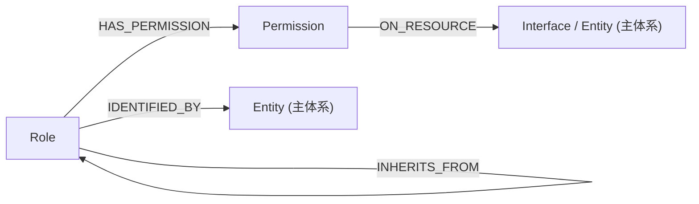

# 访问控制域 — RBAC 子系统

## 领域定位

访问控制域回答"**谁能访问什么**"——它把执行主体（Role）和授权条目（Permission）
从治理域中拆了出来，与"性能底线 / 第三方依赖"这类约束与依赖的制品分开。

- **域内制品**：[Role](role.md)、[Permission](permission.md)
- **不归本域**：Constraint / Metric / Dependency（治理域）——约束"必须做到什么"，
  与"谁被允许做什么"是两件事

## 设计原则

本子系统遵循 NIST RBAC 模型（含角色继承），为主制品体系提供"谁可以做什么"的结构化定义。

1. **RBAC1（层级模型）**：Role 之间可以单继承，子角色自动获得父角色的全部 Permission（关系 `INHERITS_FROM`）。
2. **Permission = Action × Resource**：每条 Permission 精确到一个动作（INVOKE / READ / WRITE / DELETE）在一个资源（Interface / Entity）上的效果（ALLOW / DENY）。
3. **显式否定优先**：同一 Role 对同一资源同时存在 ALLOW 和 DENY 时，DENY 优先。
4. **引用主体系制品**：Permission 的受控资源就是主制品体系里的 Interface / Entity（关系 `ON_RESOURCE`），不另建资源目录。

---

## 制品总览

| 制品类型 | ID 模式 | 文件 | 用途 |
|---------|---------|------|------|
| [Role](role.md) | `ROLE-\d+` | `role.md` | 参与者角色——身份条件、权限集合、继承关系 |
| [Permission](permission.md) | `PERM-\d+` | `permission.md` | 授权条目——动作 × 资源 × 效果 |

---

## 关系图

---

## 关系边类型

| 边类型 | 起点 | 终点 | 语义 |
|--------|------|------|------|
| `HAS_PERMISSION` | Role | Permission | 角色拥有该授权条目 |
| `INHERITS_FROM` | Role | Role | 子角色继承父角色的全部权限 |
| `IDENTIFIED_BY` | Role | Entity | 角色对应的主体实体 |
| `ON_RESOURCE` | Permission | Interface / Entity | 授权作用于哪个资源 |

---

## 与主制品体系的接口

| 主体系制品 | 关系 | 说明 |
|-----------|---------|------|
| [Requirement](../requirement/requirement.md) | `← Requirement.ACTED_BY` | 需求的执行角色 |
| [User Story](../requirement/user-story.md) | `← User Story.ACTED_BY` | 用户故事的执行角色 |
| [Interface](../contract/interface.md) | `← Interface.AUTHORIZED_BY` | 接口的授权角色 |
| [Entity](../contract/entity.md) | `← Role.IDENTIFIED_BY` | 角色身份实体 |
| [Interface](../contract/interface.md) | `← Permission.ON_RESOURCE` | 受控接口 |
